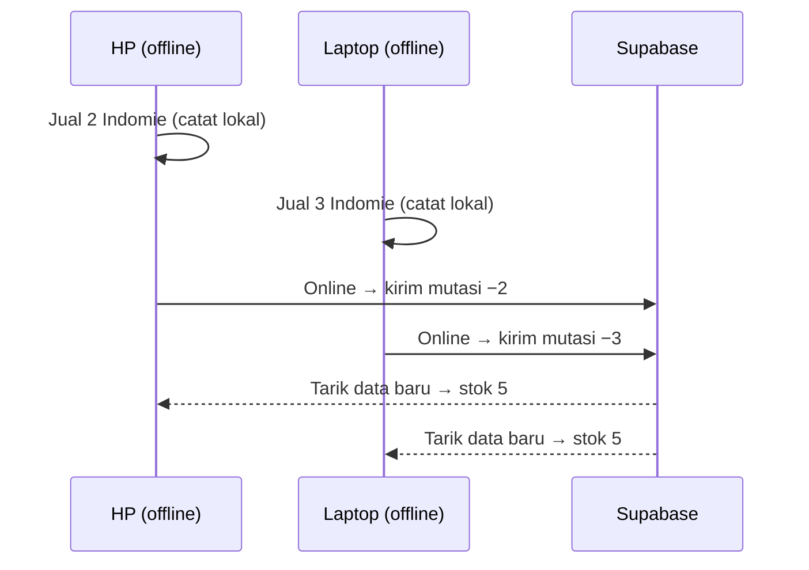

# Rencana v2: Aplikasi Kasir Warung Madura (Supabase + Offline)

## Tujuan
Aplikasi kasir web untuk **satu pemilik**, bisa dipakai di **HP dan laptop**, tetap jalan **saat offline**, dan menyinkronkan data ke **Supabase** begitu online. Tiap penjualan memotong stok, dan pemilik bisa atur harga serta restok.

## Yang berubah dari v1
| v1 | v2 |
|---|---|
| Data cuma di satu perangkat | Data di **Supabase** (cloud) dan salinannya di tiap perangkat |
| Tanpa login | **Login 1 akun pemilik**, pendaftaran akun baru ditutup |
| Backup manual | Supabase jadi cadangannya. Ekspor CSV tetap ada sebagai opsi |
| Satu perangkat | **HP + laptop** dengan data yang sama |

## Yang masuk (Goals)
- **Kasir**: cari/tap barang → keranjang → total → uang bayar → kembalian → simpan. Bisa jalan offline.
- **Barang**: tambah/ubah/arsipkan barang. Datanya nama, kategori, satuan, harga modal, harga jual, dan batas minimum stok.
- **Restok & Koreksi Stok** (koreksi wajib pakai alasan).
- **Peringatan stok menipis** + daftar belanja.
- **Laporan**: omzet harian, laba kotor, barang terlaris, riwayat transaksi.
- **Indikator sinkron**: 🟢 online & tersinkron / 🟡 ada N data menunggu dikirim / 🔴 offline.
- **Bisa di-install (PWA)** di HP dan laptop, terbuka walau tanpa sinyal.

## Tidak masuk dulu
Kasbon/utang, multi-penjaga & hak akses, printer struk, scan barcode, harga grosir.

## Anti-goal
- Transaksi hilang karena sinyal putus.
- Stok jadi kacau setelah HP dan laptop sinkron.
- Kasir lambat (transaksi biasa harus di bawah 10 detik, termasuk saat offline).

---

## Kunci Desainnya: Stok Dihitung dari Catatan Mutasi

Masalah utama offline + 2 perangkat: misalnya stok Indomie 10, HP offline jual 2, laptop offline jual 3. Kalau tiap perangkat cuma kirim angka "stok sekarang", hasilnya salah (8 atau 7, padahal seharusnya 5).

**Solusinya:** jangan simpan angka stok sebagai sumber kebenaran. Simpan **catatan perubahan** (mutasi): `jual −2`, `jual −3`, `restok +24`, `koreksi −1 (rusak)`.
**Stok = jumlah semua mutasi.** Catatan dari perangkat mana pun cukup ditambahkan, nggak ada yang saling timpa, jadi hasilnya selalu benar setelah sinkron.

Aturan tambahan:
- **ID dibuat di perangkat** (UUID), jadi transaksi offline nggak bentrok dan aman dikirim ulang. Kalau terkirim dua kali, yang kedua diabaikan.
- **Stok bisa minus sementara** kalau dua perangkat offline menjual stok terakhir. Ini nggak diblokir (penjualannya memang terjadi), tapi barangnya ditandai merah supaya bisa dikoreksi.
- **Data barang** (harga, nama): kalau diubah di dua perangkat, **perubahan terakhir yang menang** (berdasarkan waktu ubah). Wajar untuk satu pemilik.
- **Laporan** disimpan bersama harga saat transaksi terjadi, jadi laporan lama nggak berubah walau harga diganti.

---

## Pilihan Cara Sinkron

| Opsi | Cara kerja | Kelebihan | Kekurangan |
|---|---|---|---|
| **A. Sinkron buatan sendiri** ⭐ | Data lokal di IndexedDB (Dexie). Transaksi masuk antrean "outbox", dikirim ke Supabase saat online, lalu data baru ditarik | Gratis, tanpa layanan tambahan, logikanya sederhana karena pakai catatan mutasi | Kode sinkron harus kita tulis dan tes sendiri |
| B. PowerSync + Supabase | Layanan sinkron khusus yang menyalin database Supabase ke SQLite di browser | Sinkron sudah teruji, banyak urusan rumit sudah ditangani | Ada layanan ketiga (ada paket gratis dengan batas), setup lebih banyak, lebih berlebihan untuk satu pengguna |
| C. Online saja + cache baca | Cuma bisa lihat data saat offline, transaksi wajib online | Paling simpel | **Nggak memenuhi kebutuhan offline** |

**Rekomendasi: Opsi A.** Dengan satu pemilik dan model mutasi, konfliknya hampir hilang, jadi sinkron buatan sendiri cukup dan nggak butuh layanan tambahan. Kalau nanti ada multi-penjaga, bisa pindah ke B.

---

## Skema Supabase (gambaran)
| Tabel | Kolom penting |
|---|---|
| `products` | id (uuid), name, category, unit, cost_price, sell_price, min_stock, is_archived, updated_at |
| `sales` | id (uuid), created_at, total, paid, change, device_id |
| `sale_items` | id, sale_id, product_id, qty, sell_price, cost_price (salinan saat jual) |
| `stock_movements` | id (uuid), product_id, type (`sale`/`restock`/`adjust`), qty_change (+/−), reason, sale_id, created_at |
| view `product_stock` | product_id, stock = SUM(qty_change) |

**Keamanan:**
- Supabase Auth dengan 1 akun email pemilik. **Pendaftaran publik dimatikan.**
- **Row Level Security** di semua tabel: hanya akun pemilik yang boleh baca/tulis.
- Kunci `anon` boleh ada di frontend karena aksesnya sudah dikunci oleh RLS.

## Keputusan yang sudah diambil
- **Cara sinkron: Opsi A** (sinkron buatan sendiri), dipilih pemilik.
- **Online/Supabase menyusul (Fase 2).** Fase 1 berjalan offline penuh di satu perangkat, tapi datanya sudah disusun supaya tinggal disambungkan ke Supabase nanti.

## Teknologi (best practice, keputusan gw)
| Bagian | Pilihan | Alasan |
|---|---|---|
| Bahasa | **TypeScript** (mode strict) | Mencegah salah tipe data, misalnya harga atau stok yang tertukar |
| Framework | **React 19 + Vite** | Standar industri, cepat, ekosistemnya besar |
| Paket manager | **pnpm** | Cepat dan hemat disk |
| Tampilan | **Tailwind CSS v4 + shadcn/ui** | Komponen siap pakai, gampang dibuat responsif dengan tombol besar |
| Navigasi | **React Router** | Pindah halaman tetap jalan offline |
| Database lokal | **Dexie** + `useLiveQuery` | IndexedDB yang mudah dipakai, tampilan otomatis update saat data berubah |
| Form & validasi | **React Hook Form + Zod** | Validasi input (harga > 0, nama wajib). Skema Zod yang sama dipakai lagi di Fase 2 |
| Offline/PWA | **vite-plugin-pwa** (Workbox) | Bisa di-install dan dibuka tanpa sinyal |
| Format uang & tanggal | `Intl.NumberFormat('id-ID')`, **date-fns** | Format "Rp 3.500" dan tanggal Indonesia |
| Tes logika | **Vitest + fake-indexeddb** | Tes stok & antrean sinkron tanpa browser |
| Tes komponen | **Testing Library** | Tes alur kasir |
| Tes end-to-end | **Playwright** | Uji alur jualan sungguhan, termasuk saat offline |
| Kualitas kode | **ESLint + Prettier** | Gaya kode konsisten |
| Fase 2 | **Supabase** (Postgres, Auth, RLS) + **Supabase CLI** untuk migrasi | Perubahan skema database tercatat di repo |
| Hosting | **Vercel** | Gratis, deploy otomatis dari GitHub |

**Aturan penting:**
- **Uang disimpan sebagai bilangan bulat Rupiah** (tanpa desimal), supaya nggak ada error pembulatan.
- **Sejak Fase 1, semua ID pakai UUID dan semua perubahan stok dicatat sebagai mutasi + masuk tabel `outbox`.** Fase 2 tinggal mengirim isi outbox, tanpa ubah struktur data.
- Logika bisnis (hitung total, simpan transaksi, hitung stok) dipisah dari tampilan supaya mudah dites.

## Halaman
1. **Login** (sekali saja per perangkat, sesi tetap tersimpan walau offline)
2. **Kasir** (halaman utama)
3. **Barang**
4. **Stok**: restok, koreksi, riwayat mutasi
5. **Laporan**
6. **Pengaturan**: status sinkron, paksa sinkron, ekspor CSV, logout

## Tahapan

### Fase 1: Offline, satu perangkat (dikerjakan sekarang)
1. Setup project (Vite + React + TS + Tailwind + shadcn/ui + ESLint/Prettier + Vitest)
2. Skema database lokal Dexie: `products`, `sales`, `sale_items`, `stock_movements`, `outbox`
3. Logika inti **dengan tes**: simpan transaksi (penjualan + mutasi + outbox dalam satu proses), hitung stok, restok, koreksi
4. Halaman Barang + data contoh warung
5. Halaman Kasir
6. Halaman Stok (restok, koreksi, riwayat)
7. Halaman Laporan
8. PWA (bisa di-install & offline) + ekspor/impor JSON sebagai cadangan sementara
9. Tes Playwright untuk alur jualan, di ukuran layar HP & laptop

> [!WARNING]
> Selama Fase 1, data **hanya ada di satu perangkat** dan belum ada login. Rajin pakai ekspor JSON sampai Fase 2 jadi.

### Fase 2: Online + Supabase (menyusul)
1. Proyek Supabase: tabel, view stok, RLS, akun pemilik, pendaftaran publik dimatikan
2. Login di aplikasi
3. Mesin sinkron: kirim isi outbox → tarik perubahan, **dengan tes** skenario 2 perangkat offline
4. Unggah data Fase 1 yang sudah ada ke Supabase
5. Indikator status sinkron
6. Deploy ke Vercel

## Pertanyaan Terbuka
1. Kalau stok sempat **minus** setelah sinkron (kasus langka di atas), cukup ditandai merah, atau lu mau aplikasi otomatis minta koreksi? *(bisa diputuskan di Fase 2)*
2. Di Fase 1, barang yang stoknya 0 **diblokir** waktu mau dijual, atau tetap boleh (stok jadi minus) karena barangnya mungkin ada di rak tapi belum dicatat?
